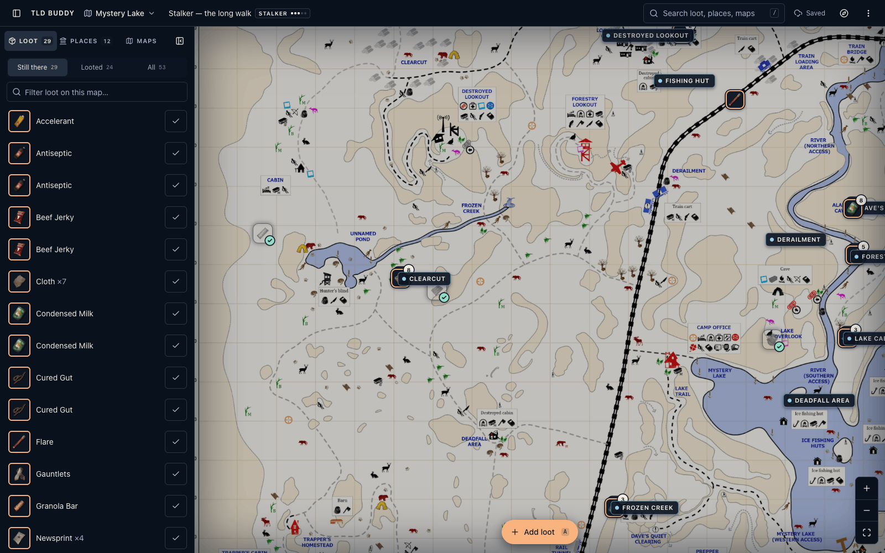
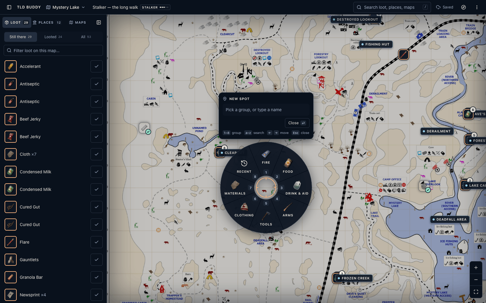
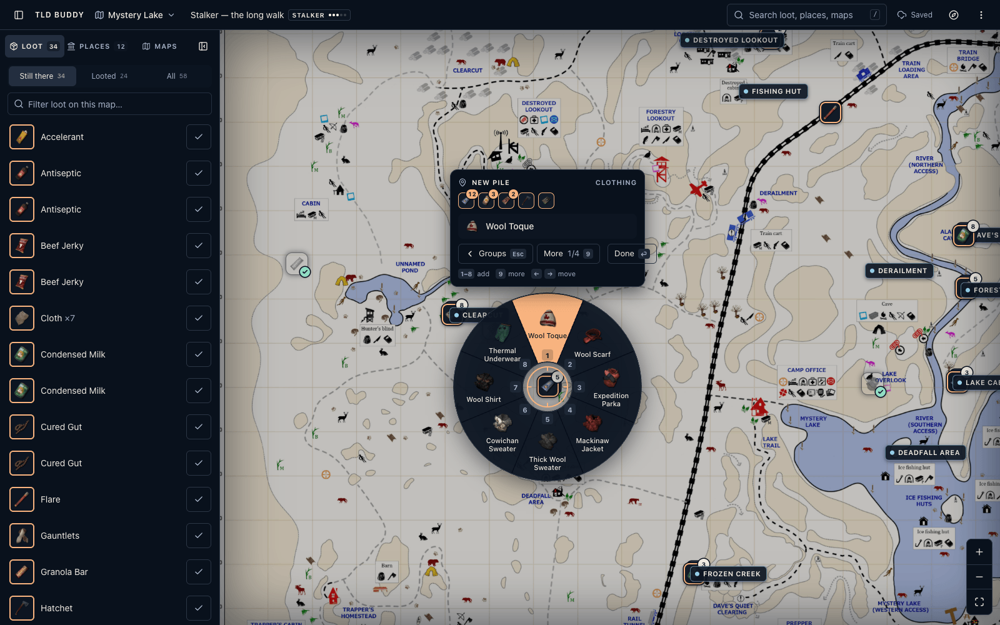
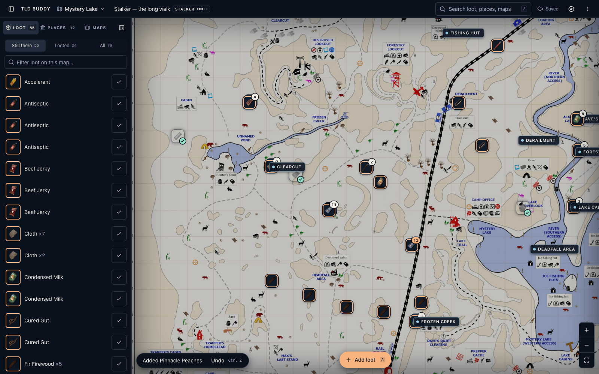
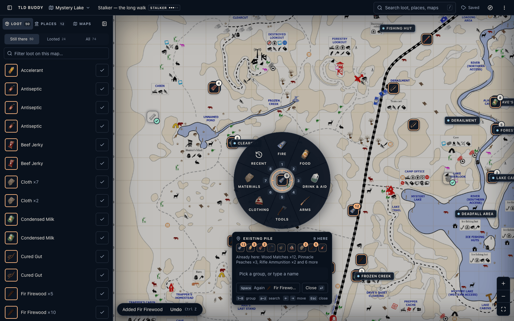
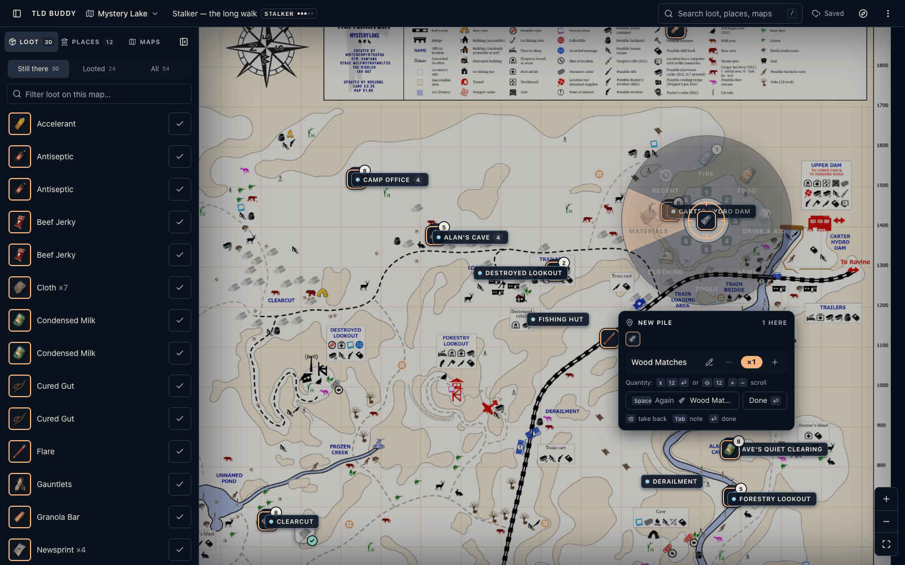
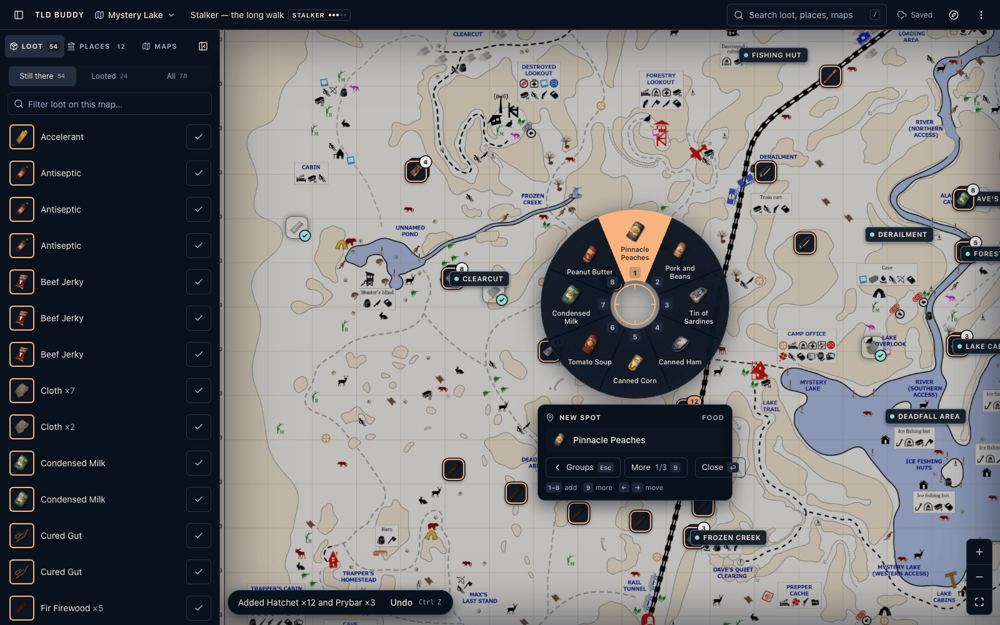
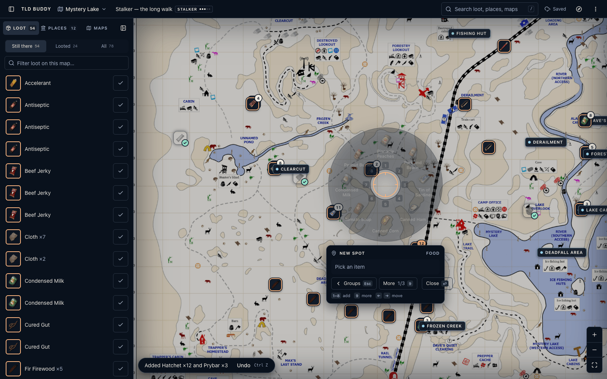

# Variant A: Wheel

The game's radial menu, opened on the map where the pointer is. Pick `?addui=a` (or ⋮ menu → Add flow → A · Wheel). Concept: [CONCEPTS.md § A](../CONCEPTS.md#a-wheel-the-games-radial-menu-at-the-cursor). Round 1 critique: [SCOREBOARD.md](../SCOREBOARD.md).

| | |
|---|---|
|  |  |
| `01-idle`: the map before adding | `02-open`: `A` with the pointer over the map: the wheel at the spot |
|  |  |
| `03-mid-batch`: 5 items in, ring 2 (Clothing, always in the same order) open, Wool Toque hovered | `04-after`: S1–S5 logged; the toast offers Undo |
|  |  |
| `s5-existing`: right-click on a pile: the plate lists what's already there before you add | `06-quantity`: right after a pick, the plate says how to set the quantity |
|  |  |
| `a11y-focus`: arrow keys move focus around the ring; each slice is a named menu item | `05-resting`: pointer away from the ring, so it fades and the map under it reads |

Also: `s3-search.png` (`hack # glovebox`: name and note in one line), `s3-note.png` (Tab note on the last pick).

## How it works

- **Opening.** `A` or `Space` while the pointer is over the map. Right-click on the map, a loot tile or a place plate also opens it, and so does Shift-click on the map or on a tile (`interceptTileClick`). The spot snaps to a pinned place or an existing pile (`resolveSpot`), so a second visit to a building joins its pile instead of starting a new ring. With no pointer on the map (the Add loot button, the palette, the panel) the shell's "Click the map where the loot is" mode comes up and that click opens the wheel.
- **The spot stays visible.** The middle of the wheel is a clear hole with an apricot crosshair, and the spot's real marker tile shows through it. The ring **rests** (fades to 32 %) right after a pick and whenever the pointer leaves it, so the map under it reads. The hole and crosshair stay at full strength. Moving the pointer back, pressing a key that changes the ring, or focusing a slice brings it back.
- **The plate** sits under the wheel, or over it when there's no room below. It shows:
  - Header: the place name, "Existing pile", "New spot", or "New pile" once something is added. Then "9 here · 2 looted".
  - **Everything at the spot** as mini tiles. Loot that's still there has an apricot ring and its quantity; looted items are washed out with a mint tick; what this wheel added has a solid ring. Each tile has a name for screen readers.
  - Before the first pick, one line in words: "Already here: Wood Matches ×12, Pinnacle Peaches ×3 and 6 more (2 looted)".
  - The live line: the hovered or focused slice, the search, the note or quantity field, or the last pick with its `×N` pill (a button), −/+ and a Note button.
  - Right after a pick, a quantity help line: "Quantity: `x 12 ⏎` or `⇧12` `+ −` scroll".
  - Again/Done, or Groups/More inside a group, then the key hints for the current stage.
- **Ring 1** has 8 fixed groups, always in the same places: `1 Fire` at 12 o'clock, then clockwise `2 Food`, `3 Drink & aid`, `4 Arms`, `5 Tools`, `6 Clothing`, `7 Materials`, `8 Recent`.
- **Ring 2** shows a group's items **in the curated `LOOT_GROUPS` order, never reshuffled**. `1 → 1` is Wood Matches every time, on every run. Only `8 Recent` follows this run's habits, and it is frozen while a wheel is open. `9` or **More** pages through. An apricot pill on an item shows how much of it is already at this spot.
- **Picking adds right away** (qty 1) and the wheel goes back to ring 1. Each pick is a real marker. One open wheel is one undo batch. The batch bookkeeping lives in `a/useWheelSession.ts`.
- **Quantity** goes to the last pick and never changes what a digit means:
  - `x` then a number and `Enter` opens a visible `×[12]` field. It's the learnable path: `Space` or `Enter` keeps the number, `Esc` cancels.
  - `Shift`+digits is the fast path (`⇧1 2` = 12; let go of Shift to start a new number).
  - Numpad digits work by physical key, with NumLock on or off.
  - `+` and `−`, the −/+ buttons, a click on the `×N` pill (opens the field), or the mouse wheel over the wheel (one notch = one).
- **Search:** any letter starts it, and the ring shows the top 8 of all items. The line takes a quantity and a note: `mat x12` is Wood Matches ×12, `hack # car trunk` is a Hacksaw with that note, and both work together. Once the line has `x` and a number or a `#`/` - ` note part, digits are typed instead of picking. `1`–`8` or a click picks a result with the parsed quantity and note. `Enter` takes the top result; on an empty line it closes. `Esc` goes back to the groups, and the plate's **Groups `Esc`** button says so.
- **Note:** `Tab` or the pencil button opens a note on the last pick. `Enter` saves and closes; `Tab` saves and goes back. A pick that stacked onto older loot gets its own marker with the note (notes never stack).
- **Same again:** `Space` (or the Again button) adds one more of the last item.
- **Mistakes:** `Backspace` (or `Ctrl+Z` while the wheel is open) takes back the last pick. After closing, `Ctrl+Z` or the toast's Undo removes the whole wheel.
- **Closing:** `Enter`, Done, `Esc` from ring 1, or a click (not a drag) outside. Dragging or zooming the map keeps it open, pinned to its spot.
- **Right-click on the wheel:** inside a group, search or field it steps back, like `Esc`. On ring 1 it does what right-click does on the map: a new wheel at that point. That keeps S4 fast when the next spot is under the ring. Right-click in the hole goes back too.
- **Edges:** the map pans so the ring fits. When it can't, the ring slides in and a dashed apricot leader points back to the spot.

## Accessibility

- The wheel is a `role="dialog"` (non-modal) named "Add loot at …", with a description of the keys. The ring is an SVG `role="menu"` named for what it shows ("Groups", "Fire items, page 1 of 3", "Search results for hack"). Each slice is a `menuitem` named with its digit and state ("3, Wood Matches, 12 already here", "1, Fire, 2 added") with `aria-keyshortcuts`. The icon and label layer is `aria-hidden`.
- Arrow keys move a roving focus around the ring (`→`/`↓` clockwise, `←`/`↑` back, `Home`/`End`). Focus shows as an apricot outline over the slice, and the plate shows the focused slice's details. `Enter` or `Space` picks it. Entering a group puts focus on its first item; after a pick, focus returns to that group's slice.
- `Tab` from the wheel reaches the ring and then the plate's buttons (Again, Done, Groups, More, −/×N/+, Note), which keep their own `Enter`, `Space` and `Tab`. With a pick present, `Tab` from the ring or wheel opens the note (`Shift+Tab` stays native).
- Mouse clicks don't move focus onto slices, so `Enter` still means Done after a mouse pick.
- A polite live region announces opening ("…, 9 items already here"), each pick with the quantity hint, quantity changes, take-backs and ring changes.
- On open, focus goes to the wheel. On close it goes back to where it was, or to the page if that was the map.

## Keyboard model

| Key | Wheel closed | Ring 1 (groups) | Ring 2 (a group) | Search line | Note / quantity field |
|---|---|---|---|---|---|
| `A` | open at the pointer (shell) | starts a search | starts a search | typed | typed |
| `Space` | **open at the pointer** (only when focus is on the page or the map) | Again; picks the focused slice | Again; picks the focused slice | typed (Again on an empty line) | saves the quantity / typed in the note |
| `1`–`8` | shell: panel tabs | open that group | add that item | add that result (typed after `x12`/`#`) | typed |
| `9` | – | – | next page | – | typed |
| `x` | – | quantity field for the last pick (a letter when nothing is picked) | same | typed | – |
| `⇧`+digits, numpad | – | quantity of the last pick | same | `⇧`+digits type `!@#…` | typed |
| `+` / `=` / `−` | shell: zoom | last pick ±1 | ±1 | typed | typed |
| `←` `→` `↑` `↓` `Home` `End` | Leaflet pan | move focus round the ring | same | `↑`/`↓` move focus, `←`/`→` move the caret | caret |
| `Enter` | – | close (picks the focused slice) | close (picks the focused slice) | add the top result (empty line: close) | save |
| `Esc` | shell: cancel / deselect | close | back to ring 1 | back to ring 1 | cancel |
| `Backspace` | shell: delete the selected marker | take the last pick back | back to ring 1 | delete a letter, then back | typed |
| `Ctrl/⌘ Z` | undo the last whole wheel (shell) | take the last pick back | same | text undo | text undo |
| `Tab` | – | note for the last pick (native with nothing picked) | same | note | save (the quantity field saves on `Tab` too) |
| letters | shell shortcuts | start a search | start a search | typed | typed |

**Conflicts, on purpose.** While a wheel is open it takes every single key: the shell's `A L H N / ? P [ 1 2 3 F + − T R E Del` are paused (`useAddUi().active`) and become search letters, choices or quantity, and `Esc` steps back. A capture-phase listener calls `preventDefault()` and `stopPropagation()`, so no digit reaches the shell's panel tabs while a wheel is open. The drive checked the panel tab before and after: unchanged. With the wheel closed, the only new key is `Space`.

## Measured counts (Chrome 1600×1000, lab Redis DB 1 freshly seeded, round 2)

Counted by the driver scripts while performing each scenario; every result was read back from `/api/data`.

| | Clicks | Keys | What was pressed | Checked in the data |
|---|---|---|---|---|
| **S1** keyboard | 0 | 31 | `A`, 9 × (group digit + item digit), 5 × `⇧`+digits (6 digits), `Enter`. No paging: all 9 items are on page 1 of the fixed order | 9 markers, 12/3/2/1/1/1/2/5/1, each on its own ring slot |
| **S1** mouse only | 20 | 0 | right-click, 9 × (group + item), Done; quantities with 19 wheel notches | same |
| **S2** learner path | 0 | 21 | `Space`, 4 × 2 digits, `x20⏎` `x6⏎` `x10⏎`, `Enter` | 20/1/6/10 |
| **S3** mouse | 3 | 18 | right-click, Tools, Hacksaw (page 1 now), `Tab`, "in the car trunk", `Enter` | Hacksaw with the note |
| **S3** one line | 0 | 18 | `A`, `hack # glovebox`, `Enter` (adds), `Enter` (closes) | Hacksaw "glovebox" |
| `mat x12` | 0 | 10 | `A`, `mat x12`, `Enter`, `Enter` | Wood Matches ×12 |
| **S4** 5 spots | 5 | 7 | spot 1: right-click, `1 3` (Fir Firewood); spots 2–5: right-click + `Space`; `Esc` | 5 firewood markers at 5 spots |
| **S5** two visits + a mistake | 2 | 22 | right-click the pile (the plate lists its 9 items), Wood Matches, Beef Jerky, Flare, `Enter`; later Shift-click the tile, Wood Matches `⇧2`, Bandage, a wrong Mukluks, `Backspace`, `Enter` | still one pile: matches 12 → 13 → 15, 3 new items, no Mukluks |
| Undo | 0 | 1 | `Ctrl+Z` after the second visit | matches back to 13, Bandage gone |

Without the mistake, S5 is 2 clicks + 18 keys. Of those, 6 keys are paging: Beef Jerky, Bandage and Mukluks are on page 2 and Flare on page 3 of the fixed order. Searching is shorter for those (`fla⏎`).

Bug checks re-run in the same drive:
- (a) Numpad `1 2` on Hatchet, mouse-pick Prybar, then Numpad `3` gives Prybar ×3 (not ×123).
- (b) Right-click on ring 2 goes back to the groups and the wheel stays open.
- (c) `Esc` in search goes back to the groups, and an empty `Enter` in search closes.
- (d) The panel tab is unchanged after every scenario.
- Arrow focus: the focused slice is "2, Food" (`menuitem`, 8 named items); `Enter` on it focuses "1, Pinnacle Peaches"; `Enter` again adds it.

Earlier checks re-run: a drag keeps the wheel open, a click outside closes it, `Space`/`Esc` open and close it, Add loot goes to aim mode, the edge clamp works, and `?addui=legacy` still opens the old dialog.

## Changes in round 2 (by critique item)

1. **Fixed order.** Groups use the curated `LOOT_GROUPS` order (no frecency sort, no per-open reshuffle). Only Recent follows habits.
2. **What's already here.** The plate lists every marker at the spot (icon, quantity, looted wash, "added now" ring, accessible names) plus a one-line "Already here" summary before the first pick. The header goes "New spot" → "New pile" after an add, and says "Existing pile" when you joined one. Right-click on a tile opens the wheel on that pile (seam), and Shift-click on a tile does too (`interceptTileClick`).
3. **Accessibility.** Slices are named `menuitem`s in a named SVG `menu`, with roving arrow-key focus, a focus outline, focus restored after ring changes and on close, a dialog description, and live announcements. The plate's buttons are reachable with `Tab`.
4. **Bugs.**
   - (a) Every pick clears the quantity buffer.
   - (b) Right-click on the ring steps back inside a group, search or field; the tooltip says `Esc`.
   - (c) Search shows a "Groups `Esc`" button and no `⏎` on Close; an empty `Enter` closes.
   - (d) Digits are swallowed while the wheel is open, and right-click on tiles now reaches the wheel.
   - Also fixed: `#` (Shift+3) is typed in the search line instead of being read as a quantity.
   - Also fixed: after closing a wheel without moving the mouse, `A`/`Space` reopen at the pointer instead of falling into aim mode (the shell loses the pointer while the wheel covers the map).
   - Also fixed: arrowing from the search line onto the ring and then typing goes back into the line.
5. **Quantity.** `x` opens a visible quantity field (learnable). A help line after every pick names all the paths. The `×N` pill is a button that opens the field. Numpad works with NumLock off. `⇧`+digits stays as the fast path.
6. **Map coverage.** The ring fades after a pick and while the pointer is away. The hole and crosshair stay clear.
7. **Grammar.** `mat x12`, `hack # car trunk` and `- note` work in the search line, and a result picked by digit or click uses the parsed quantity and note.

Maintainability: batch bookkeeping moved out of the component into `a/useWheelSession.ts`. `wheel.ts` stays pure, with 19 unit tests in `scripts/test-add-item-a.ts`, including the new keyboard model, the search grammar and NumLock-off numpad.

## Objections

- **#1, the cost of fixed order.** Stable order is right for muscle memory, but the curated `LOOT_GROUPS` order puts some common loot deep: Flare is item 17 of Fire (page 3), Beef Jerky 10 of Food, Bandage 9 of Drink & aid. That's why S5 needed 6 paging keys. The fix belongs in the shared seam (reorder the curated lists by how often players log things, e.g. Flare into Fire's first 8), so I didn't fork the order in A.
- **#4b, right-click doesn't step back on ring 1.** On the top ring it stays "a new wheel here". Making it back/close there would cost S4 an extra right-click at every spot that lies under the ring (S4 was 5 clicks + 7 keys). Inside a group, search or field it steps back, which matches the game and the Esc key.
- **#5, quantity stays off the plain digits.** Plain digits still always choose. A quantity on plain digits needs a separator after every pick, ×1 items included. `x` is the learnable path and `⇧`+digits the fast one; both are spelled out on the plate after each pick.
- **#6, fade only, no shrink.** Shrinking would move slices away from where the pointer expects them. Fading clears the view without changing the geometry.

## Seam changes

None this round. I used the lab's `interceptTileClick`, tile right-click, `scale()`-aware `resolveSpot` and the merged `amend`/`ringSlot`. From round 1, now on the lab branch: `useAddItem().amend()` and `ringSlot` in `planBatch`. `package.json`'s `test` also runs `scripts/test-add-item-a.ts`.

## Files

- `app/components/add/AddUiA.vue`: UI state, keyboard and pointer wiring, seam handlers.
- `app/components/add/a/useWheelSession.ts`: one wheel's picks and undo batch (pick, quantity, take back, note, summary).
- `app/components/add/a/WheelRing.vue`: the SVG ring (accessible menu items, focus outline, resting fade, hole, crosshair).
- `app/components/add/a/WheelReadout.vue`: the plate (place, what's here, live line, quantity field, help, actions, key hints).
- `app/components/add/a/wheel.ts`: pure geometry, the keyboard model (`readKey`), search grammar, quantity entry, pick bookkeeping.

## Known gaps

- **Common items deep in the curated order** (see Objections #1).
- **It covers about 300 px when awake**, plus a 312×~250 plate; resting helps but doesn't remove it.
- **Click only.** There's no press-drag-release marking-menu flick yet.
- **The note applies to the last pick only.**
- **Clicking the shared toast's Undo while a wheel is open** closes the wheel first.
- **The edge leader line** mostly runs under the ring.
- **Not tested with a screen reader in this round.** The roles, names and focus were checked in the DOM only (VoiceOver/NVDA not run).
- **Touch:** long-press opens the wheel and taps work; nothing touch-specific was built.

## Next

A pinned "my top 8" per group (drag to reorder) instead of only the curated order. A right-button press-drag-release flick. A real screen-reader pass.
